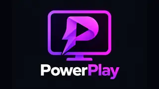
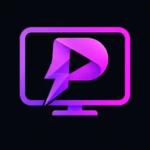

<div align="center">



# PowerPlay

**A lean, Plex-first media player for Amazon Fire TV — built for the remote, optimized for the hardware, and ready for Home Assistant.**

[](https://github.com/The-Power-0/PowerPlay/releases/latest)
[](LICENSE)
[](#compatibility)

*An independent, GPL-3.0-licensed derivative of [Plezy](https://github.com/edde746/plezy); not affiliated with or endorsed by Plex, Plezy, or Amazon.*

[Download](#download) · [Why PowerPlay?](#the-story) · [Features](#what-makes-powerplay-different) · [Home Assistant](#home-assistant-automations) · [Version history](#version-history) · [Source & license](#source-releases-and-license)

</div>

---

## Download

### [**Get the latest PowerPlay release →**](https://github.com/The-Power-0/PowerPlay/releases/latest)

**This link always opens the current stable release.** Under **Assets**, choose the **`PowerPlay-*.apk`** file to install on a Fire TV Stick; the source archive, native-source inputs, and checksums are provided alongside it. This page intentionally does not hard-code an APK version, so new releases do not leave the download section behind.

> **Installation:** Install the signed APK using ADB or your preferred Fire TV sideloading tool. If you already have PowerPlay installed, a signed update can install in place when the signing certificate matches. If Android reports `INSTALL_FAILED_UPDATE_INCOMPATIBLE`, the installed copy uses a different signing key: uninstalling it is required before installing that build, and **uninstalling removes its local app data**.

Example from a computer with Android platform tools, after downloading the APK:

```bash
adb install -r PowerPlay-vX.Y.Z.apk
```

Browse all historical builds in [Releases](https://github.com/The-Power-0/PowerPlay/releases). For the exact source of any particular APK, download that release's **`-Source.tar.gz`** and **`-NativeSourceInputs.zip`** assets rather than assuming GitHub's automatically generated source archive matches the built APK.

## The story

PowerPlay began as a small practical problem: **make a Fire TV launch a Plex show's continuous shuffle from Home Assistant**, without navigating through a streaming-app interface every time. The first experiments added a `plezy://shuffle` intent to a custom build of [Plezy](https://github.com/edde746/plezy), so a household automation could start a show directly.

That useful little deep link grew into a dedicated Fire TV optimization project. As the fork evolved, the focus shifted to *only what our Fire Sticks actually need*: Plex movies and TV shows, responsive D-pad navigation, efficient artwork loading, reliable playback, and external control. The work included stripping out unused integrations and features, tuning startup, network activity and memory, and moving video playback to **ExoPlayer/Media3** instead of shipping MPV.

Once the optimized test build was working, it deserved an identity of its own. **PowerPlay** introduced the purple artwork shown above, an independent Android package (`com.power.powerplay`), its own `powerplay://` URI scheme, separate app data, and release workflows. It can coexist with the original Plezy app.

Today the focus is still the same: **a fast, comfortable Plex experience on Fire TV, with the ability to make playback part of a smart home.** PowerPlay is independently maintained; new upstream Plezy changes are considered selectively rather than automatically merged.

## What makes PowerPlay different

| | |
| --- | --- |
| 🎬 **Plex-first** | Focused on movies and TV shows; removes unnecessary Jellyfin support, music workflows, Discover/requests, Watch Together, companion-remote functionality and third-party scrobbling integrations from the Fire TV edition. |
| ⚡ **Fire TV performance** | Startup, artwork prioritization, Plex request handling, navigation responsiveness and memory budgets tailored for Fire OS hardware. |
| ▶️ **Media3 playback** | ExoPlayer/Media3 video with FFmpeg codec libraries; no MPV player runtime in the distributed build. |
| 🏠 **Automation-ready** | Android deep links let Home Assistant open the app or start continuous shuffled-show playback. |
| 📺 **Hardware-aware libraries** | Known 1080p-only Fire Sticks start with libraries named `[4K]` hidden; 4K-capable models keep them visible even if HDMI output is currently 1080p. |
| 🎨 **Independent identity** | PowerPlay purple artwork, startup screens and About page, with a package and URI scheme separate from Plezy. |

Library hiding is a **default, not a restriction**: users can manually show a hidden library. Explicit Show/Hide selections persist per device profile. Unknown hardware keeps libraries visible by default.

### Compatibility

PowerPlay's published builds target **Amazon Fire OS 7 and 8**, with a signed **32-bit ARM (`armeabi-v7a`) APK**, and are designed primarily for Fire TV Stick hardware. The published build workflow performs APK, signing, version-code, deep-link and playback-runtime checks. Those automated checks **do not replace physical-device playback testing**; review each release's notes for validation details.

## Smart home integration

PowerPlay is designed to work with external automation systems, including **Home Assistant**. It listens for Android **VIEW intents** using its own `powerplay://` URI scheme, allowing another app or controller to open PowerPlay and request supported Plex playback actions.

### What PowerPlay understands

| Capability | How it works |
| --- | --- |
| **Launch from another system** | Android can deliver a PowerPlay deep link to the app. |
| **Target a Plex server and show** | A link can specify a Plex server ID and a show's rating key, so there is no need to navigate the library manually. |
| **Continuous TV-show shuffle** | A shuffle link starts randomized episode playback of the selected show. |
| **Control individual Fire TVs** | Send the intent to whichever Fire Stick should play; each device runs its own PowerPlay instance. |

For example, this link requests shuffled playback of a particular show:

```text
powerplay://shuffle?server=SERVER_ID&show=SHOW_RATING_KEY
```

The equivalent native-style playback link is:

```text
powerplay://play?server=SERVER_ID&id=SHOW_RATING_KEY&mode=shuffle
```

Replace the placeholders with the **Plex server ID** and the show's **rating key**, not their display names. The Android package is `com.power.powerplay`; its links and app data are independent of the original Plezy app.

### Using it with Home Assistant

Home Assistant can use its **Android TV integration and ADB commands** to send these deep links to a Fire Stick. This makes it possible to start a favorite show's shuffle from a dashboard button, a scene, a schedule, or a presence-based automation—without manually navigating the PowerPlay interface.

Home Assistant handles the surrounding logic, such as turning on the television, waiting for the Fire Stick to become responsive, and choosing which room to target. **PowerPlay handles the incoming playback request.** There is no separate built-in Home Assistant integration or automatic TV power management required by the app.

## Version history

PowerPlay's version numbers began with the standalone rebrand. Earlier releases used **Plezy**'s version numbers and are kept in a [legacy archive](docs/archive/README.md).

| Release | Milestone |
| --- | --- |
| **[1.1.2](https://github.com/The-Power-0/PowerPlay/releases/tag/powerplay-v1.1.2)** | Splash backgrounds now match the approved logo canvas throughout Fire TV light, dark, OLED and Android 12 launch paths. |
| **[1.1.1](https://github.com/The-Power-0/PowerPlay/releases/tag/powerplay-v1.1.1)** | Hardware-aware `[4K]` library defaults: hide on recognized 1080p-only sticks, show on 4K-capable sticks regardless of current output resolution; preserve manual overrides. |
| **[1.1.0](https://github.com/The-Power-0/PowerPlay/releases/tag/powerplay-v1.1.0)** | Improved Fire TV defaults: Continue Watching/Episode Action open details, content-frame-rate matching on, automatic intro skip after three seconds; extended startup and About branding. |
| **[1.0.0](https://github.com/The-Power-0/PowerPlay/releases/tag/powerplay-v1.0.0)** | First standalone PowerPlay release: purple branding, `com.power.powerplay`, `powerplay://` intents, and the frozen Plex-only Fire TV optimization stack based on Plezy 2.25.0. |
| **Pre-1.0 · October 2026** | Custom Plezy 2.22–2.25 builds established Home Assistant shuffle links; subsequent performance work consolidated the Fire TV feature set, removed unused integrations and MPV, and produced the tested candidate later rebranded as PowerPlay. |

For a future release that is not yet listed here, use [Latest](https://github.com/The-Power-0/PowerPlay/releases/latest). Full per-version changes and downloadable artifacts are recorded on each GitHub release page.

### Release approach

Small individual features typically increment the patch version (`1.1.0 → 1.1.1`), while a feature batch can increment the minor version. Stable publications are explicitly marked **Latest**. Release candidates are built and checked before a separate, manually approved publishing step. PowerPlay's build process currently restores a checksum-pinned 1.0.0 baseline and applies reviewed version-specific patches; the historical source tree at repository root should **not** be mistaken for the exact source of the published APK. See [the release candidate workflow](.github/workflows/powerplay-release-candidate.yml), [publication workflow](.github/workflows/powerplay-publish.yml) and [release metadata](.github/powerplay/release.json).

## Artwork

<div align="center">
  
  <p><i>The original approved PowerPlay logo and Fire TV banner are preserved under <a href="docs/artwork">docs/artwork</a>.</i></p>
</div>

## Source releases and license

PowerPlay is based on **[Plezy by edde746](https://github.com/edde746/plezy)** and is distributed under the **[GNU General Public License v3](LICENSE)**. The [upstream README](UPSTREAM-README.md) is retained for background and attribution; original copyright and applicable third-party notices are preserved. PowerPlay is unofficial and independent of Plex, Plezy and Amazon.

**To reproduce a released APK, use its matching `PowerPlay-…-Source.tar.gz` attachment and pinned native-source inputs**, along with its checksums and included build instructions. GitHub's automatically generated source-code downloads may not represent the exact compiled build. The signing key is not included in source releases.

A full audit of **transitive native-dependency licensing/source obligations** has not yet been completed; the project does not claim comprehensive dependency-license or trademark clearance. Review those obligations before further redistribution.

<sub>Built around one simple idea: press a button, pick a show, and let PowerPlay handle the rest.</sub>
